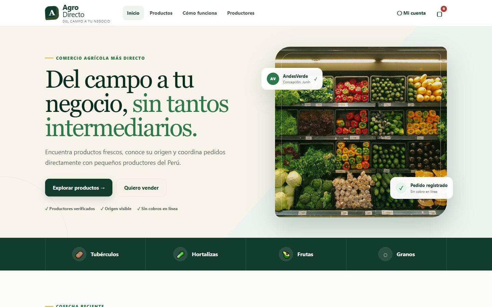

# AgroDirecto — Frontend

Plataforma web que conecta a pequeños agricultores del Perú con restaurantes, bodegas y comercios **a precio justo y sin intermediarios**: el agricultor recibe su precio completo, el comprador paga primero y el dinero queda protegido hasta la entrega.

Este repositorio es la interfaz web. Consume la API de [`agrodirecto-backend`](https://github.com/lesssC/agrodirecto-backend) (Spring Boot + MySQL). El plan de trabajo está en [ROADMAP.md](ROADMAP.md); el contexto del producto en [PRODUCT.md](PRODUCT.md) y el sistema visual en [DESIGN.md](DESIGN.md).



## Cómo levantar el proyecto localmente

Requisitos: **Docker Desktop**, **Node.js 22.13 o superior** y **pnpm**. No hace falta instalar Java ni MySQL.

```bash
# 1. Backend (API + MySQL), en la carpeta agrodirecto-backend
docker compose up -d --build        # la primera vez tarda unos minutos
curl localhost:8080/actuator/health # debe responder {"status":"UP"}

# 2. Frontend, en esta carpeta
cp .env.example .env.local          # VITE_API_URL=http://localhost:8080
pnpm install
pnpm dev                            # abre http://localhost:3000
```

Para detener: `pnpm dev` se corta con `Ctrl+C`, y el backend con `docker compose down` (los datos se conservan; `docker compose down -v` los borra y vuelve a cargar la demostración).

### Cuentas de demostración

Contraseña de todas: `demo1234`. En la pantalla de inicio de sesión, "Cuentas de demostración" las completa con un clic.

| Cuenta                      | Rol                                                  |
| --------------------------- | ---------------------------------------------------- |
| `compras@saborandino.pe`    | Comprador verificado                                 |
| `donlucho@correo.pe`        | Comprador nuevo (con topes de cuenta nueva)          |
| `andesverde@agrodirecto.pe` | Productor con cuenta propia                          |
| `promotora@agrodirecto.pe`  | Agente de campo con 5 agricultores · **pide código** |
| `admin@agrodirecto.pe`      | Administración · **pide código**                     |

Las cuentas que piden código usan verificación en dos pasos. Agrega su clave en Google Authenticator (u otra app) con "Ingresar clave de configuración":

| Cuenta                     | Clave                              |
| -------------------------- | ---------------------------------- |
| `promotora@agrodirecto.pe` | `AGRODIRECTOAGENTEDEMO234567ABCDE` |
| `admin@agrodirecto.pe`     | `AGRODIRECTOADMINDEMO234567ABCDEF` |

## Qué se puede hacer

- **Comprador:** buscar por producto, región de entrega u orgánico; ver la ficha con presentaciones, precio por kg y **comparación con el precio de mercado**; conocer al productor (historia, reputación, reseñas, zonas de entrega y mapa aproximado); armar el carrito; ver el **desglose transparente** (cuánto llega al agricultor y cuánto es el servicio); pagar (simulado, con dinero retenido); seguir el pedido en vivo; confirmar la recepción, reclamar con foto o calificar.
- **Productor y agente de campo:** registrar agricultores sin computadora, verificarlos en persona, publicar productos con varias presentaciones y **alertas de precio bajo**, atender pedidos (aceptar, rechazar, avanzar), definir zonas de entrega y reenviar por WhatsApp los mensajes que recibe el agricultor por SMS.
- **Administración:** cuánto del dinero llega al agricultor, verificación y sanción de cuentas con motivo, resolución de disputas con la versión de ambas partes, precios de referencia y auditoría.
- **Seguridad:** inicio de sesión con JWT y verificación en dos pasos (TOTP con código QR y códigos de respaldo) para administración y agentes.
- **Tiempo real:** pedidos, stock y avisos se actualizan sin recargar (WebSocket STOMP).

## Tecnologías

React 19 y TypeScript · Vinext/Vite · Bootstrap 5 y CSS propio · Leaflet y OpenStreetMap · `@stomp/stompjs` (WebSocket) · `qrcode` · Vitest · desplegado en Cloudflare Workers.

## Organización del código

Ver [docs/estructura.md](docs/estructura.md).

## Verificación

```bash
pnpm typecheck      # tipos
pnpm lint           # reglas de código y accesibilidad
pnpm format:check   # formato (Prettier)
pnpm test           # pruebas unitarias (Vitest) + compilación + pruebas de renderizado
```

## Despliegue

En Cloudflare se define la variable `VITE_API_URL` con la dirección pública del backend (por ejemplo `https://agrodirecto-api.onrender.com`) antes de compilar. El backend debe incluir el dominio del frontend en sus orígenes permitidos (CORS).

## Trabajo en equipo

Cómo clonar, levantar localmente y subir cambios: ver [CONTRIBUTING.md](CONTRIBUTING.md).

## Equipo

- Jaime Israel Aramburu Condori.
- Leslie Liliana Cabrera Luley.
- Jose Antonio Morote Sanchez.
- Andrés Ronaldo Bayona Manrique.

Curso: Desarrollo Full Stack — UTP, sección 45554, 2026.
